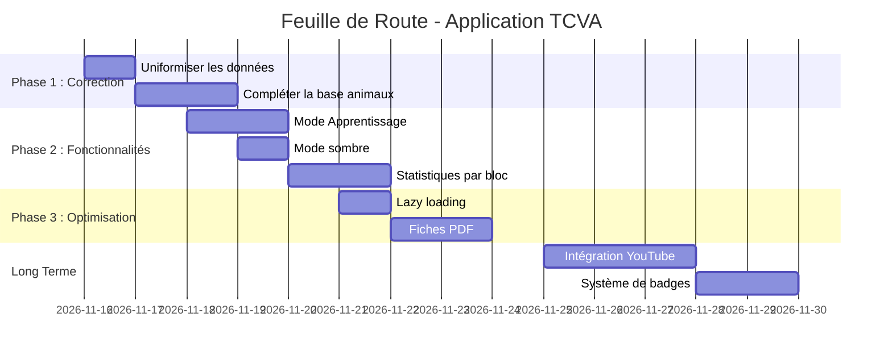

# 📋 Recommandations pour l'Application Bac Pro TCVA

*Généré le 16 novembre 2026 - Application de révision pour le Baccalauréat Professionnel Technicien Conseil-Vente en Animalerie*

---

## 🎯 **Table des Matières**
1. [Améliorations Pédagogiques (Haute Priorité)](#-améliorations-pédagogiques-haute-priorité)
2. [Améliorations UI/UX (Moyenne Priorité)](#-améliorations-uiux-moyenne-priorité)
3. [Fonctionnalités Techniques](#-fonctionnalités-techniques-optimisation)
4. [Contenu Pédagogique (Long Terme)](#-contenu-pédagogique-long-terme)
5. [Top 5 Recommandations pour Démarrer](#-top-5-recommandations-pour-demain)

---

## 📚 **Améliorations Pédagogiques (Haute Priorité)**

### 1️⃣ Module Animaux : Compléter la Base de Données
**Objectif** : Offrir une couverture complète des espèces d'animalerie.

- [ ] **Ajouter +20 animaux par catégorie** (actuellement 5-8, total 45 oiseaux)
- [ ] **Uniformiser les clés des caractéristiques** :
  ```javascript
  // ❌ À corriger :
  esperanceVie: '10-15 ans'  // Dans animals-db.js
  'Espérance de vie'        // Dans le mapping JS
  
  // ✅ Solution :
  // Soit utiliser partout 'esperanceVie' (sans espace)
  // Soit créer un mapping centralisé
  ```
- [ ] **Vérifier les images** : Toutes les références `.png` doivent exister dans `/tcva-app/img/`
- [ ] **Ajouter des champs utiles** :
  ```javascript
  {
    id: 'animal-XXX',
    name: 'Nom commun',
    scientific: 'Nom scientifique',
    category: 'catégorie',
    description: '...',
    characteristics: {
      taille: 'X-Y cm',
      poids: 'X-Y kg/g',
      esperanceVie: 'X-Y ans',
      temperament: '...',
      niveauActivite: 'Faible/Moyen/Élevé'
    },
    needs: {
      alimentation: '...',
      espace: '...',
      exercice: '...',
      compatibilite: 'Seul/Groupe'
    },
    origin: 'Pays/Région',
    image: '../img/animal-XXX.png',
    funFact: '...',
    regulation: '...',
    advice: '...',
    prixMoyen: '50-150€',
    niveauDifficulte: 'Débutant/Intermédiaire/Expert'
  }
  ```

### 2️⃣ Quiz : Modes d'Apprentissage Variés
**Objectif** : Adapter le quiz aux différents niveaux et besoins des élèves.

- [ ] **Mode "Apprentissage"** :
  - Pas de chronomètre
  - Réponse immédiate avec explication détaillée
  - Pas de score, juste un suivi de progression
- [ ] **Mode "Défi Chrono"** :
  - 10 questions en 2 minutes
  - Classement local (stocké dans localStorage)
  - Récompenses (badges virtuels)
- [ ] **Quiz par Animal** :
  - Sélectionner un animal spécifique
  - Questions ciblées sur cet animal
- [ ] **Quiz Visuel** :
  - Identifier l'animal à partir de l'image uniquement
  - 4 options avec images miniatures

### 3️⃣ Statistiques Avancées
**Objectif** : Permettre aux élèves de suivre leur progression de manière précise.

- [ ] **Suivi par bloc** :
  - Pourcentage de maîtrise par bloc de compétences
  - Nombre de questions vues/réussies par bloc
- [ ] **Historique visuel** :
  - Graphiques de progression (intégration de Chart.js)
  - Courbe d'évolution des scores sur le temps
- [ ] **Analyse des erreurs** :
  - Liste des questions souvent ratées
  - Lien direct vers la révision de ces questions
  - Statistiques par type d'erreur

---

## 🎨 **Améliorations UI/UX (Moyenne Priorité)**

### 4️⃣ Design & Navigation

| Élément | Problème Actuel | Solution Proposée |
|---------|----------------|-------------------|
| Mode sombre | Non disponible | Toggle dans le header + sauvegarde localStorage |
| Mobile | Affichage parfois cassé | Vérifier les media queries pour tous les composants |
| Feedback visuel | Statique | Animations CSS pour ✅/❌ |
| Barre de progression | Basique | Couleurs dynamiques (rouge <50%, orange 50-75%, vert >75%) |

**Code pour le mode sombre** :
```css
:root {
  --bg-color: #ffffff;
  --text-color: #333333;
  --primary-color: #4CAF50;
}

.dark-mode {
  --bg-color: #1a1a1a;
  --text-color: #f0f0f0;
  --primary-color: #4CAF50;
}

body {
  background-color: var(--bg-color);
  color: var(--text-color);
}
```

### 5️⃣ Module Animaux : Fonctionnalités Interactives

- [ ] **Comparaison visuelle** :
  - Afficher les images des animaux côte à côte dans le tableau de comparaison
  - Zoom sur hover
- [ ] **Galerie photo** :
  - Diaporama des animaux par catégorie
  - Filtres par taille/poids/prix
- [ ] **Recherche avancée** :
  - Filtres combinés (ex: "Chiens de taille moyenne, prix < 1000€")
  - Recherche full-text dans toutes les caractéristiques
- [ ] **Système de favoris** :
  - Bouton ⭐ sur chaque carte d'animal
  - Page dédiée "Mes favoris"
  - Export de la liste des favoris

---

## 🔧 **Fonctionnalités Techniques (Optimisation)**

### 6️⃣ Performances

- [ ] **Lazy loading des images** :
  ```html
  
  ```
- [ ] **Cache local** :
  - Sauvegarder les données des quiz/animaux en localStorage
  - Réduire les rechargements inutiles
- [ ] **Pagination** :
  - 20 questions par page dans la liste des questions
  - Boutons "Précédent/Suivant"

### 7️⃣ Sécurité & Maintenance

- [ ] **Backup des données** :
  - Bouton "Exporter" pour sauvegarder questions/animaux en JSON
  - Bouton "Importer" pour restaurer
- [ ] **Validation des données** :
  - Script pour vérifier que toutes les images référencées existent
  - Détection des doublons d'IDs
- [ ] **Versioning** :
  - Ajouter un fichier `version.json`
  - Notification des mises à jour disponibles

---

## 📚 **Contenu Pédagogique (Long Terme)**

### 8️⃣ Ressources Complémentaires

- [ ] **Fiches PDF** :
  - Génération automatique de fiches par bloc
  - Contenu : Questions + réponses + explications
  - Style imprimable
- [ ] **Intégration YouTube** :
  - Lien vers des tutoriels pour chaque bloc
  - Embed des vidéos directement dans l'application
- [ ] **Glossaire** :
  - Page dédiée aux termes techniques
  - Recherche instantanée
  - Exemples : NAC, Espérance de vie, Réglementation, etc.

### 9️⃣ Communauté & Collaboration

- [ ] **Partage de quiz** :
  - Générer un lien partageable avec une sélection de questions
  - Format : `?bloc=B1&niveau=Facile&count=10`
- [ ] **Système de commentaires** :
  - Permettre aux élèves d'ajouter des notes personnelles
  - Stockage local ou en ligne (si hébergé)
- [ ] **Classement** (si hébergé) :
  - Meilleur score par bloc
  - Tableau de classement entre élèves (optionnel)

---

## 🚀 **TOP 5 Recommandations pour Démarrer**

| # | Action | Effort | Impact | Priorité |
|---|--------|--------|--------|----------|
| 1 | **Compléter la base animaux** (10+ par catégorie) | ⭐⭐ | ⭐⭐⭐⭐ | 🔥 **URGENT** |
| 2 | **Ajouter le mode "Apprentissage"** (sans score, avec explications immédiates) | ⭐⭐ | ⭐⭐⭐⭐ | 🔥 **URGENT** |
| 3 | **Corriger l'uniformité des clés** (`esperanceVie` partout) | ⭐ | ⭐⭐⭐⭐ | 🔥 **URGENT** |
| 4 | **Mode sombre** | ⭐⭐ | ⭐⭐⭐ | ⚡ **IMPORTANT** |
| 5 | **Statistiques par bloc** (pourcentage de maîtrise) | ⭐⭐⭐ | ⭐⭐⭐⭐ | ⚡ **IMPORTANT** |

---

## 📌 **Checklist par Phase**

### Phase 1 : Correction & Complétion (1-2 jours)
- [ ] Uniformiser les clés dans `animals-db.js`
- [ ] Vérifier que toutes les images `.png` existent
- [ ] Ajouter 5 animaux par catégorie (minimum)
- [ ] Tester toutes les fonctionnalités existantes

### Phase 2 : Nouvelles Fonctionnalités (3-5 jours)
- [ ] Implémenter le mode "Apprentissage"
- [ ] Ajouter le mode sombre
- [ ] Créer les statistiques par bloc
- [ ] Ajouter le système de favoris

### Phase 3 : Optimisation & Contenu (1 semaine)
- [ ] Implémenter le lazy loading
- [ ] Ajouter la pagination
- [ ] Créer les fiches PDF
- [ ] Intégrer des vidéos YouTube

---

## 💡 **Idées Bonus (Innovation)**

- **Système de badges** : Récompenser les élèves pour leurs progrès (ex: "Expert Chiens", "Maître des NAC")
- **Quiz aléatoire quotidien** : Une question par jour à l'ouverture de l'application
- **Mode "Duel"** : 2 joueurs sur le même appareil, questions en alternance
- **Intégration avec Google Classroom** : Synchronisation des scores pour les enseignants
- **QR Codes** : Générer des QR codes pour accéder rapidement à un quiz spécifique

---

## 📊 **Feuille de Route Suggestée**



---

## 🔗 **Ressources Utiles**

- **Chart.js** : https://www.chartjs.org/ (pour les graphiques de progression)
- **Font Awesome** : https://fontawesome.com/ (icônes pour les badges)
- **PDF.js** : https://mozilla.github.io/pdf.js/ (pour générer des PDF côté client)
- **Lazysizes** : https://github.com/aFarkas/lazysizes (pour le lazy loading)

---

## 📝 **Notes**

- Toutes les recommandations sont **modulaires** : vous pouvez les implémenter dans n'importe quel ordre.
- Priorisez en fonction de **l'impact pédagogique** pour vos élèves.
- Les modifications de la base de données (`animals-db.js`) sont **critiques** pour la cohérence de l'application.
- Pensez à **sauvegarder** votre travail avant chaque mise à jour majeure.

---

*Document généré par Mistral Vibe - Application de révision Bac Pro TCVA*